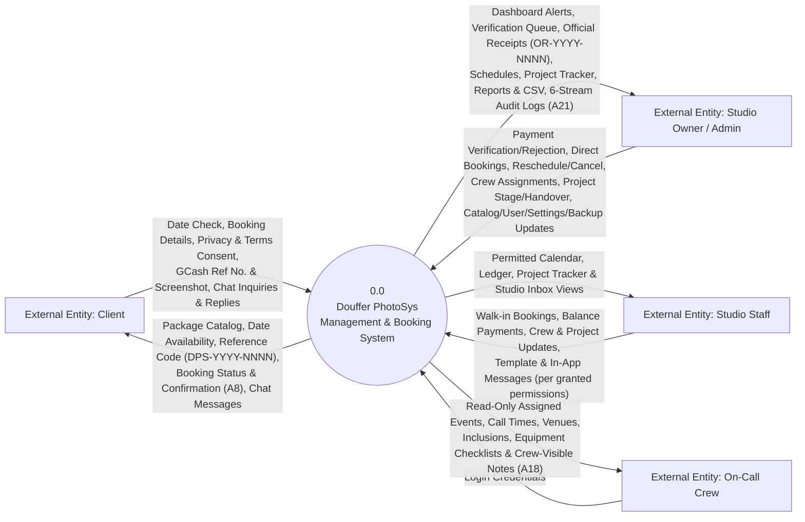
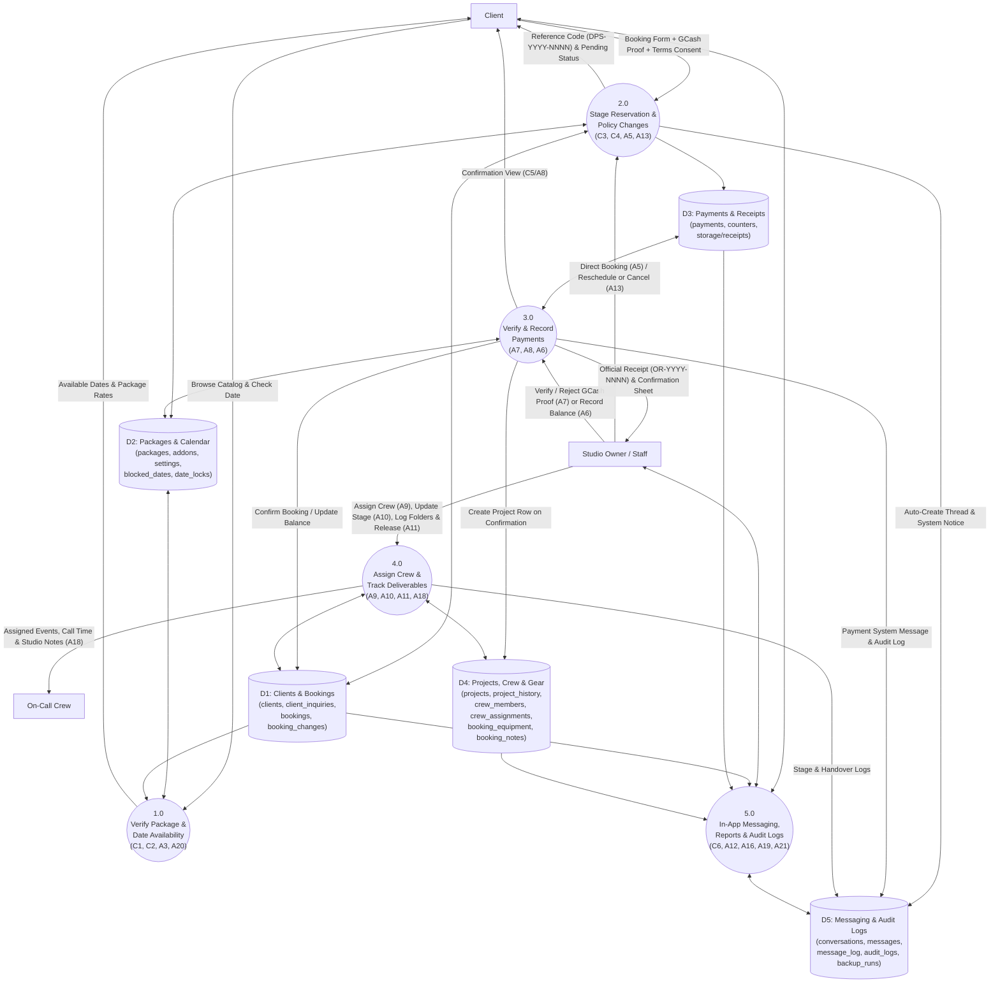
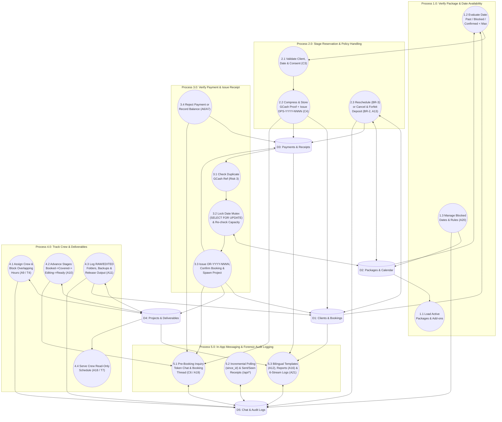

# Douffer PhotoSys: Data Flow Diagrams (DFD)

Generated from the actual implementation of **Douffer PhotoSys** per `PROMPT.md` §13.4.

---

## 1. Context Diagram

Shows the system boundary and the external entities (**Client**, **Studio Owner / Admin**, **Studio Staff**, and **On-Call Crew**) interacting with **Douffer PhotoSys**.

---

## 2. DFD Level 0 (System Overview)

Decomposes the system into the core processes (**1.0 Verify Package & Date Availability**, **2.0 Stage Reservation**, **3.0 Verify Payment**, **4.0 Track Deliverables**, and **5.0 Manage In-App Messaging & Logs**) and core data stores (**D1–D5**).

---

## 3. DFD Level 1 — Detailed Process & Data Store Flows

Shows the step-by-step internal sub-processes for **1.0–4.0** plus the **In-App Messaging & Audit Trail** flows.

