# Douffer PhotoSys: Entity-Relationship Diagram (ERD)

This Entity-Relationship Diagram matches the exact 29-table 3NF schema implemented in [`database/schema.sql`](../database/schema.sql) (MySQL 5.7+ / MariaDB 10.3+, InnoDB, `utf8mb4`, `DECIMAL(10,2)` for monetary columns, `RESTRICT` foreign keys per Business Rule `BR-8`).

```mermaid
erDiagram
    users {
        INT id PK
        VARCHAR name
        VARCHAR username UK
        VARCHAR email
        VARCHAR password_hash
        ENUM role "owner, staff, crew"
        TINYINT perm_view_bookings
        TINYINT perm_record_payments
        TINYINT perm_verify_payments
        TINYINT perm_archive_records
        TINYINT perm_manage_messages
        TINYINT must_change_password
        TINYINT is_active
        DATETIME last_login_at
        DATETIME password_changed_at
        DATETIME created_at
    }

    clients {
        INT id PK
        VARCHAR full_name
        VARCHAR mobile
        CHAR mobile_normalized
        VARCHAR messenger_name
        ENUM contact_channel "messenger, call, walk_in, referral, website"
        DATETIME privacy_consent_at
        TINYINT is_archived
        DATETIME created_at
    }

    client_inquiries {
        INT id PK
        INT client_id FK
        ENUM channel "messenger, call, walk_in, referral, website"
        TEXT note
        INT created_by FK
        DATETIME created_at
    }

    packages {
        INT id PK
        VARCHAR name
        ENUM category "photo, video, photo_video, other"
        VARCHAR description
        TEXT inclusions
        DECIMAL price
        DECIMAL down_payment_override
        TINYINT is_active
        INT sort_order
        DATETIME created_at
        DATETIME updated_at
    }

    addons {
        INT id PK
        VARCHAR name
        DECIMAL price
        TINYINT is_active
    }

    counters {
        VARCHAR name PK
        SMALLINT year PK
        INT last_value
    }

    bookings {
        INT id PK
        VARCHAR reference_code UK "DPS-YYYY-NNNN"
        INT client_id FK
        INT package_id FK
        VARCHAR event_type
        DATE event_date
        TIME start_time
        TIME end_time
        VARCHAR venue
        TEXT special_requests
        ENUM source_channel "messenger, call, walk_in, referral, website"
        ENUM status "pending, confirmed, completed, cancelled"
        DECIMAL package_price
        DECIMAL total_amount
        DECIMAL down_payment_due
        TINYINT is_archived
        VARCHAR terms_version
        DATETIME terms_accepted_at
        DATETIME privacy_consent_at
        DATETIME confirmed_at
        DATETIME cancelled_at
        DATETIME completed_at
        DATETIME archived_at
        INT created_by FK
        DATETIME created_at
    }

    booking_addons {
        INT booking_id PK,FK
        INT addon_id PK,FK
        DECIMAL price_at_booking
    }

    booking_changes {
        INT id PK
        INT booking_id FK
        ENUM change_type "created, status, reschedule, cancel, archive, restore, note"
        VARCHAR old_value
        VARCHAR new_value
        VARCHAR reason
        INT changed_by FK
        DATETIME changed_at
    }

    booking_notes {
        INT id PK
        INT booking_id FK
        TEXT body
        TINYINT visible_to_crew
        INT created_by FK
        DATETIME created_at
    }

    payments {
        INT id PK
        INT booking_id FK
        ENUM type "down, balance, other"
        ENUM method "gcash, cash, other"
        DECIMAL amount
        VARCHAR gcash_reference_no
        VARCHAR receipt_path
        VARCHAR receipt_thumb_path
        ENUM status "pending, verified, rejected"
        VARCHAR rejection_reason
        TINYINT is_forfeited
        VARCHAR receipt_no UK "OR-YYYY-NNNN"
        ENUM submitted_via "portal, admin"
        INT duplicate_ack_by FK
        DATETIME duplicate_ack_at
        INT recorded_by FK
        INT verified_by FK
        DATETIME verified_at
        DATETIME paid_at
        VARCHAR notes
        DATETIME created_at
    }

    blocked_dates {
        INT id PK
        DATE date UK
        VARCHAR reason
        INT created_by FK
        DATETIME created_at
    }

    date_locks {
        DATE date PK
    }

    crew_members {
        INT id PK
        VARCHAR name
        ENUM type "owner, photographer, videographer, other"
        VARCHAR phone
        INT user_id UK,FK
        TINYINT is_on_call
        TINYINT is_active
    }

    crew_assignments {
        INT id PK
        INT booking_id FK
        INT crew_member_id FK
        ENUM role "lead, backup"
        TIME call_time
        INT assigned_by FK
        DATETIME created_at
    }

    equipment_items {
        INT id PK
        VARCHAR name
        VARCHAR category
        TINYINT is_active
    }

    booking_equipment {
        INT booking_id PK,FK
        INT equipment_item_id PK,FK
        TINYINT is_checked
    }

    projects {
        INT id PK
        INT booking_id UK,FK
        ENUM stage "booked, covered, editing, ready, released"
        DATE due_date
        TINYINT editing_done
        TINYINT rendering_done
        TINYINT album_done
        VARCHAR raw_folder
        VARCHAR edited_folder
        TINYINT local_backup_done
        DATETIME local_backup_at
        TINYINT cloud_copy_done
        DATETIME cloud_copy_at
        ENUM released_how "pickup, messenger_link, other"
        VARCHAR released_note
        DATE released_at
        VARCHAR received_by
        INT released_by FK
        DATETIME created_at
        DATETIME updated_at
    }

    project_history {
        INT id PK
        INT project_id FK
        VARCHAR old_stage
        VARCHAR new_stage
        INT changed_by FK
        DATETIME changed_at
    }

    message_templates {
        INT id PK
        VARCHAR template_key UK
        VARCHAR title
        TEXT body_tl
        TEXT body_en
        TINYINT is_active
        INT sort_order
    }

    message_log {
        INT id PK
        INT booking_id FK
        VARCHAR template_key
        ENUM language "tl, en"
        TEXT body
        ENUM channel "copy, in_app"
        INT sent_marked_by FK
        DATETIME sent_at
    }

    conversations {
        INT id PK
        INT booking_id UK,FK
        INT client_id FK
        VARCHAR guest_name
        VARCHAR guest_mobile
        CHAR access_token_hash UK
        DATETIME privacy_consent_at
        ENUM status "open, closed"
        DATETIME last_message_at
        DATETIME created_at
    }

    messages {
        INT id PK
        INT conversation_id FK
        ENUM sender_type "client, admin, system"
        INT sender_user_id FK
        TEXT body
        VARCHAR attachment_path
        DATETIME read_at
        DATETIME created_at
    }

    quick_replies {
        INT id PK
        VARCHAR title
        VARCHAR body
        TINYINT is_active
    }

    settings {
        VARCHAR setting_key PK
        TEXT setting_value
    }

    terms_versions {
        INT id PK
        VARCHAR version UK
        TEXT body
        DATE effective_from
        DATETIME created_at
    }

    audit_logs {
        BIGINT id PK
        INT user_id FK
        VARCHAR action
        VARCHAR entity
        INT entity_id
        TEXT details
        VARCHAR ip
        DATETIME created_at
    }

    backup_runs {
        INT id PK
        DATETIME created_at
        VARCHAR file_name
        BIGINT size_bytes
        ENUM type "manual, scheduled"
        INT created_by FK
        DATETIME cloud_copy_marked_at
    }

    rate_limits {
        VARCHAR rl_key PK
        INT window_start PK
        INT hits
    }

    clients ||--o{ client_inquiries : "has inquiries"
    users ||--o{ client_inquiries : "records"
    clients ||--o{ bookings : "places"
    packages ||--o{ bookings : "selected in"
    users ||--o{ bookings : "creates"
    bookings ||--o{ booking_addons : "includes"
    addons ||--o{ booking_addons : "attached via"
    bookings ||--o{ booking_changes : "logs timeline"
    users ||--o{ booking_changes : "changes"
    bookings ||--o{ booking_notes : "has internal notes"
    users ||--o{ booking_notes : "writes"
    bookings ||--o{ payments : "paid via"
    users ||--o{ payments : "verifies/records"
    users ||--o{ blocked_dates : "blocks"
    users ||--o| crew_members : "links account"
    bookings ||--o{ crew_assignments : "staffed by"
    crew_members ||--o{ crew_assignments : "assigned to"
    users ||--o{ crew_assignments : "assigns"
    bookings ||--o{ booking_equipment : "uses gear"
    equipment_items ||--o{ booking_equipment : "checked in"
    bookings ||--|| projects : "spawns on confirm"
    users ||--o{ projects : "releases"
    projects ||--o{ project_history : "tracks stages"
    users ||--o{ project_history : "moves stage"
    bookings ||--o{ message_log : "logs notifications"
    users ||--o{ message_log : "dispatches"
    bookings ||--o| conversations : "has thread"
    clients ||--o{ conversations : "participates in"
    conversations ||--o{ messages : "contains"
    users ||--o{ messages : "sends reply"
    users ||--o{ audit_logs : "audited as actor"
    users ||--o{ backup_runs : "triggers backup"
```

