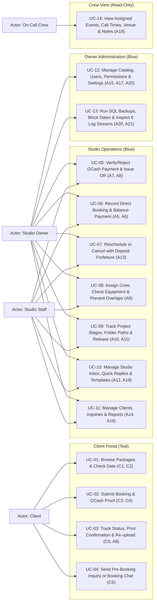

# Douffer PhotoSys: Use Case Specifications

Generated from the actual implementation of **Douffer PhotoSys** per `PROMPT.md` §13.5.

---

## 1. Actor Overview

| Actor | Role Description | Accessible Screens & Routes |
|---|---|---|
| **Client** *(Public Visitor)* | Prospective or existing event client without a login account. Accesses own booking via reference code + normalized Philippine mobile number (`09XXXXXXXXX`) or inquiry chat token. | `C1` (`/`), `C2` (`/availability`), `C3` (`/book`), `C4` (`/book/pay`), `C5` (`/booking`, `/booking/{ref}`), `C6` (`/chat`, `/chat/t/{token}`, `/booking/{ref}/chat`), `A8 Client View` (`/booking/{ref}/confirmation`), `/privacy` |
| **Owner** *(Mr. Jeffrey D. Madrigal)* | Studio proprietor with unrestricted administrative privileges across all booking, financial, crew, deliverable, catalog, user, backup, and audit screens. | `A1–A17`, `A19–A21`, `MORE` (`/admin/*`, `/account/password`) |
| **Staff** *(Studio Assistant)* | Authenticated studio assistant whose access is dynamically governed on every request by 5 permission flags (`view_bookings`, `record_payments`, `verify_payments`, `archive_records`, `manage_messages`). | `A1`, `A2`, `MORE`, `/account/password`, plus permitted routes among `A3–A14`, `A16`, `A19` |
| **Crew** *(On-Call Photographer / Videographer)* | Freelance event coverage member restricted strictly to a read-only view of their own assigned events (`A18`) with zero financial or chat data exposed. | `A1` (`/admin/login`), `A18` (`/crew`), `/account/password` |

---

## 2. Detailed Use Cases by Actor

### 2.1 Client Use Cases

#### UC-01: Browse Packages & Check Date Availability (`C1`, `C2`)
- **Primary Actor:** Client
- **Routes:** `GET /`, `GET /availability?month=YYYY-MM&date=YYYY-MM-DD`
- **Preconditions:** None.
- **Main Success Scenario:**
  1. Client opens `/` (`C1`) and views active Photo & Video packages (inclusions, rates) and Other Services chips.
  2. Client taps **Check availability / Book now** to open `/availability` (`C2`).
  3. System evaluates each date in the selected month via `AvailabilityService::monthMap()` (`BR-1`, `BR-4`): past dates, blocked dates (`blocked_dates`), and dates with `confirmed` non-archived bookings `>= settings.max_events_per_day` are crossed out and non-selectable.
  4. Client selects an open date (e.g. `2026-12-15`) and taps **Continue to booking details** (`C3`).
- **Alternate Flows:**
  - *Unavailable Date Tapped:* System displays `"Sorry, this date is not available. Please choose another date."`

#### UC-02: Submit Booking Request & GCash Down Payment Proof (`C3`, `C4`, Scenario `T1`)
- **Primary Actor:** Client
- **Routes:** `GET /book`, `POST /book`, `GET /book/pay`, `POST /book/pay`
- **Preconditions:** Selected date passes `AvailabilityService::isDateAvailable()`.
- **Main Success Scenario:**
  1. On `C3` (`/book`), Client enters full name, mobile number, optional Messenger name, event type, package, event date/time, venue, special requests, and ticks the **RA 10173 Privacy Consent** checkbox.
  2. Server re-validates all fields and date availability, stores a session draft, and redirects to `C4` (`/book/pay`).
  3. System calculates the required down payment (`BookingService::downPaymentFor()`, default 30% rounded up to the nearest ₱50) and displays the studio's GCash account details and QR code.
  4. Client selects a GCash receipt screenshot (compressed client-side via `pay.js` canvas to ≤1600 px JPEG), enters the GCash reference number, ticks the non-refundable down payment policy checkbox (recording `terms_version` and `terms_accepted_at`), and submits.
  5. Inside a DB transaction, `BookingService::createPending()` issues a unique sequential reference code (`DPS-YYYY-NNNN`), creates the `pending` booking and `pending` payment row, auto-creates the booking conversation with a system welcome message, logs `booking_created` and `payment_proof_uploaded` to `audit_logs`, and redirects to `C5` (`/booking/{ref}`).

#### UC-03: Look Up Booking Status, Print Confirmation & Re-upload Rejected Proof (`C5`, `A8`)
- **Primary Actor:** Client
- **Routes:** `GET /booking`, `POST /booking`, `GET /booking/{ref}`, `POST /booking/{ref}/reupload`, `GET /booking/{ref}/confirmation`
- **Main Success Scenario:**
  1. Client enters `reference_code` and `mobile` on `/booking` (throttled by `RateLimiter`).
  2. Upon match, system grants session ownership for that booking ID and displays `C5` (`/booking/{ref}`): 3-step progress bar, payment status, balance, and project stage.
  3. Once confirmed, Client can open `/booking/{ref}/confirmation` (`A8`) to print their Booking Confirmation.
- **Alternate Flows:**
  - *Payment Rejected:* `C5` displays the studio's rejection reason and allows the client to upload a replacement screenshot + reference number (`POST /booking/{ref}/reupload`), placing a new `pending` payment into `A7`.

#### UC-04: Pre-Booking Inquiry & Booking In-App Chat (`C6`, Scenario `T11`)
- **Primary Actor:** Client
- **Routes:** `GET /chat`, `POST /chat/start`, `GET /chat/t/{token}`, `GET /booking/{ref}/chat`, `POST /api/conversations/{id}/messages`, `GET /api/conversations/{id}/messages?since_id=N`
- **Main Success Scenario:**
  1. Visitor without a booking opens `/chat`, provides name, mobile, message, and RA 10173 consent (with hidden honeypot `website` check).
  2. `MessageService::startInquiry()` generates a 64-character random hex token, stores only `SHA-256(token)` in `conversations.access_token_hash`, and redirects to `/chat/t/{token}`.
  3. Client (via token or verified booking session) sends plain-text messages (up to 1,000 chars) and optional image attachments (`≤ 2 MB` JPG/PNG/WebP).
  4. `chat.js` polls `/api/conversations/{id}/messages?since_id=N` every 4.5s while visible (20s hidden backoff, paused offline) and updates `Sent` → `Seen` receipts.

---

### 2.2 Studio Owner & Permitted Staff Use Cases

#### UC-05: Verify or Reject GCash Payment with Race-Safe Date Locking & Duplicate Check (`A7`, `A8`, Scenarios `T2`, `T8`, `T9`)
- **Primary Actor:** Owner or Staff with `verify_payments`
- **Routes:** `GET /admin/payments`, `POST /admin/payments/{id}/verify`, `POST /admin/payments/{id}/reject`
- **Main Success Scenario:**
  1. Actor opens `/admin/payments` (`A7`) and inspects waiting payments, zoomed receipt screenshots (`/files/receipt/{id}`), and waiting-request counts on the same date.
  2. If the GCash reference number matches any other payment (`PaymentService::duplicatesOf()`), `A7` displays a prominent fraud warning requiring the `ack_duplicate` checkbox before verification (`T9`).
  3. On **Verify**, `PaymentService::verify()` starts a DB transaction, acquires a `SELECT ... FOR UPDATE` mutex on `date_locks` for the event date (`BR-4`, `T8`), re-runs `AvailabilityService::isDateAvailable()`, issues sequential official receipt `OR-YYYY-NNNN`, marks the booking `confirmed`, creates the `projects` row (`stage = 'booked'`, `due_date = event_date + default_delivery_days`), posts an automated system message in chat, writes to `audit_logs` and `booking_changes`, and redirects to `A8` (`/admin/bookings/{id}/confirmation`).
- **Alternate Flows:**
  - *Date Just Became Full (`T8`):* Transaction aborts cleanly with `"This date just became full. Reschedule or reject."`
  - *Reject Payment:* Actor selects a rejection reason (`screenshot unclear`, `amount doesn't match`, `other`); payment becomes `rejected`, booking remains `pending`, and client is notified in chat.

#### UC-06: Record Direct Booking & Balance Payment (`A5`, `A6`, Scenario `T6`)
- **Primary Actor:** Owner or Staff with `view_bookings` / `record_payments`
- **Routes:** `GET/POST /admin/bookings/new`, `POST /admin/bookings/{id}/payments`
- **Main Success Scenario:**
  1. On `A5` (`/admin/bookings/new`), actor logs a walk-in/call/Messenger booking and optionally ticks **Down payment received now** to confirm immediately with an `OR-YYYY-NNNN` receipt.
  2. On `A6` (`/admin/bookings/{id}`), actor records a balance payment (`cash`/`gcash`/`other`), reducing the remaining balance to `₱0.00` and issuing a new `OR-YYYY-NNNN` receipt (`T6`).

#### UC-07: Reschedule or Cancel Booking with Deposit Forfeiture (`A13`, Scenarios `T3`, `T10`)
- **Primary Actor:** Owner or Staff with `view_bookings` (`archive_records` for cancel)
- **Routes:** `GET/POST /admin/bookings/{id}/change`
- **Main Success Scenario:**
  1. **Reschedule (`BR-3`, `T3`):** Actor chooses an open future date and enters a reason. Inside a `date_locks` transaction, the system updates `event_date`, recalculates `projects.due_date`, logs to `booking_changes` and `audit_logs` (`booking_rescheduled`), and posts a system chat notice at ₱0 fee.
  2. **Cancel (`BR-2`, `T10`):** Actor ticks `confirm_forfeit` and enters a reason. System sets booking `status = 'cancelled'`, marks verified down payments `is_forfeited = 1` (non-refundable), frees the date capacity immediately, and logs `booking_cancelled`.

#### UC-08: Assign Crew, Check Equipment & Block Overlapping Hours (`A9`, Scenario `T4`)
- **Primary Actor:** Owner or Staff with `view_bookings`
- **Routes:** `GET /admin/crew`, `POST /admin/crew/assign`, `POST /admin/crew/unassign`, `POST /admin/crew/equipment`
- **Main Success Scenario:**
  1. Actor opens `/admin/crew?date=YYYY-MM-DD` (`A9`). If any active event on that date has zero crew assigned, a red shortage banner is shown.
  2. Actor assigns an active crew member (`lead`/`backup`) with optional call time.
  3. `CrewService::assign()` verifies the member is not assigned to another event on the same date with overlapping hours (`start1 < end2 && start2 < end1`). If overlapping, it throws `CrewOverlapConflictException`.
  4. Once all events have crew, the banner turns green (`All Events Covered`). Actor checks off equipment items (`booking_equipment`).

#### UC-09: Track Project Stages, Log Folder Paths & Release Deliverables (`A10`, `A11`, Scenario `T5`)
- **Primary Actor:** Owner or Staff with `view_bookings`
- **Routes:** `GET /admin/projects`, `POST /admin/projects/{id}/stage`, `POST /admin/projects/{id}/checklist`, `GET/POST /admin/projects/{id}/files`
- **Main Success Scenario:**
  1. On `A10` (`/admin/projects`), actor updates the editing checklist (`editing_done`, `rendering_done`, `album_done`) and advances project stage linearly across `booked → covered → editing → ready` (`BR-7`), logging each transition in `project_history`.
  2. On `A11` (`/admin/projects/{id}/files`), actor records RAW and EDITED folder paths (`BR-10`), local backup and cloud copy checkboxes, release method (`pickup`, `messenger_link`, `other`), and recipient.
  3. When marking `released`, if cloud copy is unchecked or balance > ₱0, the system requires `confirm_release_override`. If balance is `₱0.00`, the booking automatically transitions to `completed`.

#### UC-10: Manage Studio Inbox, Quick Replies & Bilingual Templates (`A12`, `A19`, Scenario `T11`)
- **Primary Actor:** Owner or Staff with `manage_messages`
- **Routes:** `GET/POST /admin/bookings/{id}/messages/templates`, `GET /admin/messages`, `GET /admin/messages/{id}`, `POST /admin/messages/{id}/status`, `POST /admin/messages/{id}/link`, `GET /admin/messages/{id}/export`
- **Main Success Scenario:**
  1. On `A12`, actor previews Tagalog/English templates with auto-filled placeholders, copies for Messenger (`message_log`), or sends directly into the client's in-app chat thread.
  2. On `A19`, actor filters the Studio Inbox (`All · Unread · Open · Closed · Inquiries`), replies using quick-reply chips, links pre-booking inquiries to a booking/client (`conversation_linked`), closes/reopens threads, or exports a `.txt` transcript.

#### UC-11: Manage Clients, Inquiries & Generate Reports (`A14`, `A16`)
- **Primary Actor:** Owner or Staff with `view_bookings`
- **Routes:** `GET/POST /admin/clients`, `GET/POST /admin/clients/{id}`, `POST /admin/clients/{id}/inquiries`, `GET /admin/reports`, `GET /admin/reports/export.csv`
- **Main Success Scenario:**
  1. On `A14`, actor searches clients, filters by contact channel, views booking/inquiry history, and logs new inquiry notes (`client_inquiries`).
  2. On `A16`, actor selects Monthly or Daily mode, inspects the 4 summary tiles (`Bookings`, `Income received`, `Outstanding balances`, `Pending outputs`), prints the report, or downloads the CSV export.

---

### 2.3 Owner-Only Administration Use Cases

#### UC-12: Manage Catalog, Users, Permissions & Studio Settings (`A15`, `A17`, `A20`)
- **Primary Actor:** Owner (`auth => 'owner'`)
- **Routes:** `/admin/packages*`, `/admin/users*`, `/admin/settings*`
- **Main Success Scenario:**
  1. On `A15`, Owner adds/edits/toggles Photo & Video packages, Other Services, and Add-ons (`package_saved`).
  2. On `A17`, Owner creates accounts (`owner`, `staff`, `crew`), updates staff permission checkboxes (`permissions_updated`), resets passwords, or deactivates accounts (`user_saved`).
  3. On `A20`, Owner updates studio info, GCash QR/details, down-payment/capacity/delivery rules, versioned terms (`terms_versions`), quick replies, and message templates (`settings_updated`).

#### UC-13: Manage Blocked Dates, Database Backups & Inspect All 6 Log Streams (`A20`, `A21`, Scenario `T13`)
- **Primary Actor:** Owner (`auth => 'owner'`)
- **Routes:** `POST /admin/settings/blocked-dates*`, `POST /admin/backups`, `GET /admin/backups/{id}/download`, `POST /admin/backups/{id}/cloud-copy`, `GET /admin/logs`, `GET /admin/logs/export.csv`
- **Main Success Scenario:**
  1. Owner blocks or unblocks calendar dates (`date_blocked`, `date_unblocked`).
  2. Owner clicks **Backup now** (or runs `php database/backup.php`), generating a full `.sql` dump in `storage/backups/`, downloading it, and marking **Cloud copy done** (`backup_created`, `backup_cloud_marked`).
  3. On `A21` (`/admin/logs`), Owner inspects, filters, prints, and exports CSV across all 6 append-only log streams (`audit_logs`, `booking_changes`, `project_history` + `projects`, `message_log` + system `messages`, `backup_runs`, and `storage/logs/app.log` + `rate_limits`).

---

### 2.4 Crew Use Case

#### UC-14: View Assigned Events, Call Time, Venue & Studio Notes (`A18`, Scenario `T7`)
- **Primary Actor:** Crew (`auth => 'crew'`)
- **Routes:** `GET /crew`
- **Main Success Scenario:**
  1. Crew member logs in at `/admin/login` and is directed to `/crew` (`A18`).
  2. System displays the crew member's **Next assigned event** card (date, start/end time, call time, role `Lead`/`Backup`, venue, client phone, package inclusions, equipment checklist, and crew-visible notes from `booking_notes`), plus later/past events.
  3. All financial figures and client chat threads are omitted, and any request to `/admin/*` or `/files/chat/*` returns `403`.
